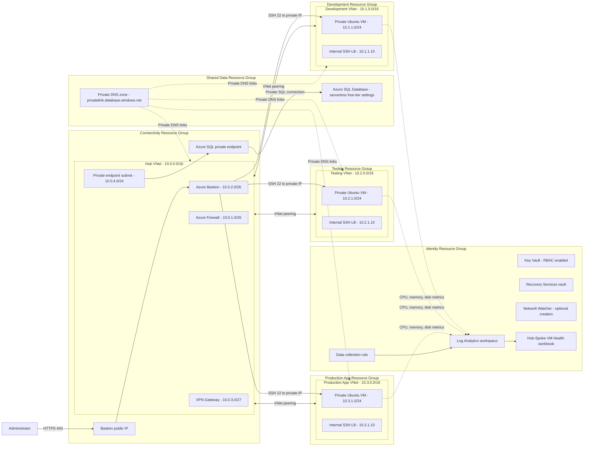

# Azure Hub-and-Spoke Landing Zone Architecture

This case-study design provisions a hub and three workload spokes in Central India, shared identity and monitoring services, and one shared Azure SQL database. Spoke VMs are private and accessed through Azure Bastion.

## Network topology

## Address plan

| Network | Address space | Subnet(s) |
| --- | --- | --- |
| Hub | `10.0.0.0/16` | AzureFirewallSubnet `10.0.1.0/26`; AzureBastionSubnet `10.0.2.0/26`; GatewaySubnet `10.0.3.0/27`; private endpoints `10.0.4.0/24` |
| Development | `10.1.0.0/16` | `10.1.1.0/24` |
| Testing | `10.2.0.0/16` | `10.2.1.0/24` |
| Production app | `10.3.0.0/16` | `10.3.1.0/24` |

There is no Production Data VM or `10.4.0.0/16` spoke. Shared data is provided by Azure SQL Database.

## Resource group boundaries

- **Connectivity:** hub VNet, Azure Firewall, Bastion, VPN Gateway and IPs, plus the SQL private endpoint.
- **Identity:** Key Vault, Log Analytics workspace, Azure Monitor data collection rule and workbook, Recovery Services vault, and optionally Network Watcher.
- **Development, Testing, Production App:** each workload VNet, subnet, NSG, Ubuntu VM, and internal SSH load balancer.
- **Shared Data:** Azure SQL logical server/database and private DNS zone linked to the hub and all three spokes.

## Access, routing, and operations

- Azure Bastion uses its public IP as the managed entry point; spoke VMs have no public IP. Connect to VM private IPs through Bastion. VM OS disks are deleted with their VMs.
- Each spoke retains a Standard internal load balancer on TCP 22 with one VM backend. These are private SSH front ends, not part of the Bastion connection path and not a failover pool.
- VNet peering connects the hub directly to each spoke. No UDRs force traffic through the Firewall; the Firewall is provisioned in the hub but does not inspect these direct peering flows.
- The VPN Gateway resource is provisioned in the hub for future configuration. A VPN connection or tunnel is not defined in this project.
- The SQL logical server has public network access disabled. The private endpoint and linked private DNS zone provide network reachability from the hub and spokes; database users and permissions must be configured separately.
- Azure Monitor collects VM performance counters for the three spoke VMs. The Recovery Services vault is present but no backup policy or protected VM is configured.
- Network Watcher creation is disabled by default because Azure permits one per subscription/region. Enable creation only after confirming that no watcher already exists in Central India.
- Firewall, Bastion, VPN Gateway, public IPs, load balancers, private endpoints, Log Analytics, and SQL usage may incur charges. Review current Azure pricing and the plan before deployment.
