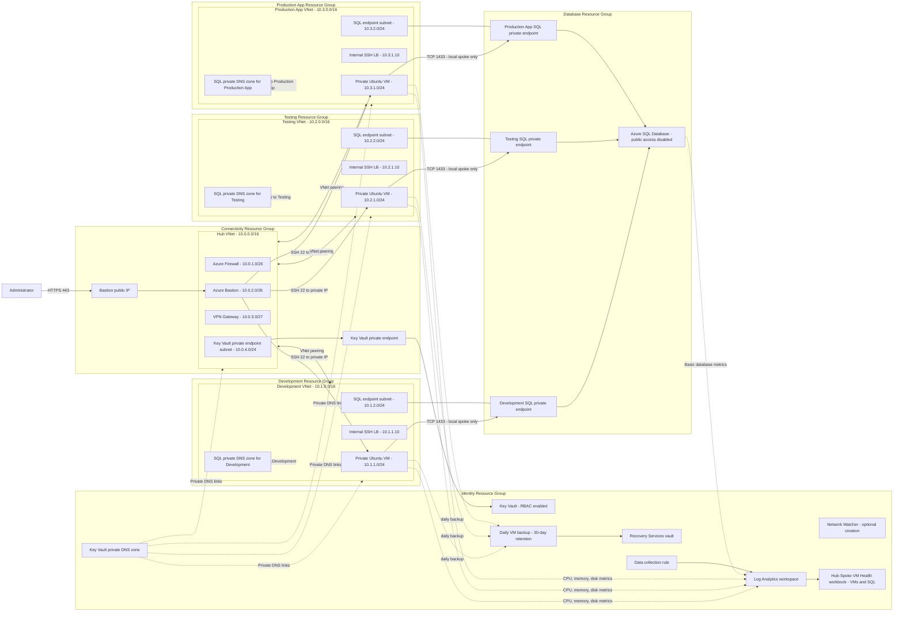

# Azure Hub-and-Spoke Landing Zone Architecture

This case-study design provisions a hub and three workload spokes in Central India, shared identity and monitoring services, a dedicated Database Resource Group, and private Azure SQL connectivity. Each spoke contains one private Ubuntu VM.

## Network topology

## Address plan

| Network | Address space | Subnet(s) |
| --- | --- | --- |
| Hub | `10.0.0.0/16` | AzureFirewallSubnet `10.0.1.0/26`; AzureBastionSubnet `10.0.2.0/26`; GatewaySubnet `10.0.3.0/27`; Key Vault private endpoints `10.0.4.0/24` |
| Development | `10.1.0.0/16` | VM `10.1.1.0/24`; SQL private endpoint `10.1.2.0/24` |
| Testing | `10.2.0.0/16` | VM `10.2.1.0/24`; SQL private endpoint `10.2.2.0/24` |
| Production app | `10.3.0.0/16` | VM `10.3.1.0/24`; SQL private endpoint `10.3.2.0/24` |

There is no Production Data VM or `10.4.0.0/16` spoke. Azure SQL Database serves as the shared PaaS database in its own resource group.

## Resource group boundaries

- **Connectivity:** hub VNet, Firewall, Bastion, VPN Gateway and IPs, plus the Key Vault private endpoint.
- **Identity:** Key Vault, Key Vault private DNS zone and VNet links, Log Analytics workspace, Azure Monitor data collection rule and workbook, Recovery Services vault and daily VM backup policy, and optionally Network Watcher.
- **Development, Testing, Production App:** each workload VNet, VM subnet, NSG, Ubuntu VM, internal SSH load balancer, SQL private endpoint subnet, and its own SQL private DNS zone.
- **Database:** Azure SQL logical server/database and three SQL private endpoint resources. Each endpoint connects to one spoke subnet; SQL endpoints are not placed in the hub.

## Access, routing, and operations

- Azure Bastion provides the managed administrator entry point. Spoke VMs have no public IPs; VM OS disks are deleted with their VMs.
- Each spoke retains a Standard internal load balancer on TCP 22 with one VM backend. These are private SSH front ends, not a failover pool.
- VNet peering connects the hub to each spoke. SQL private DNS zones are linked only to their corresponding spokes. Each SQL endpoint subnet allows TCP 1433 from its local spoke address space and denies other VNet sources, including the hub.
- The SQL logical server has public network access disabled. Per-spoke private endpoints and DNS let each workload connect to its local private endpoint; no SQL endpoint is placed in the hub. Azure SQL uses Azure-managed standard backups only; it is not backed up to the Recovery Services vault and has no long-term retention policy here.
- Key Vault public network access is disabled. A private endpoint in the hub and private DNS links allow private name resolution from all four VNets. RBAC is enabled; grant workload identities only the required data-plane roles before applications use the vault.
- Azure Monitor collects VM performance counters for all three spoke VMs. SQL Basic metrics are sent to the same Log Analytics workspace and shown in the Hub-Spoke VM Health workbook. The Recovery Services vault protects the VMs daily with 30-day retention.
- The VPN Gateway resource is provisioned in the hub; connection details must be configured separately.
- Network Watcher creation is disabled by default because Azure permits one per subscription/region. Enable it only after confirming that no watcher already exists in Central India.
- Firewall, Bastion, VPN Gateway, public IPs, load balancers, private endpoints, VM backups, SQL metric ingestion, Log Analytics, and SQL usage may incur charges. Review current Azure pricing and the plan before deployment.
