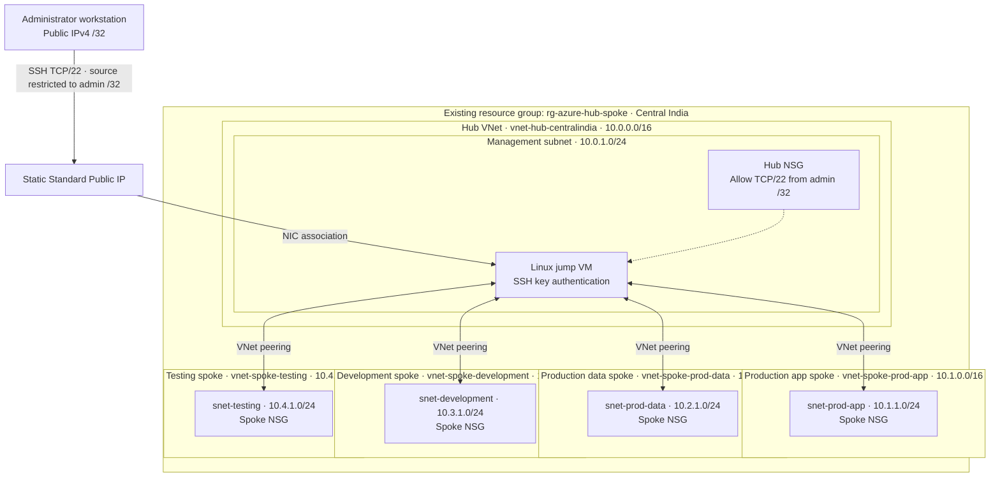

# Azure Hub-and-Spoke Network Architecture

Proposed topology for `Hub-Spoke-Networking-Infrastructure` in Central India, based on the project's Terraform notes and the referenced [Azure Landing Zone hub-spoke pattern](https://github.com/shekhar1414/Azure-Landing-Zone-Terraform#network-topology-diagram).

## Network topology

## Access and boundaries

- **No VPN:** No VPN gateway or VPN connection is included.
- **Public entry:** The jump VM is the only resource with a public IP. SSH is intended to be restricted to the administrator's current public IPv4 `/32` and use SSH key authentication.
- **Private spoke access:** Spoke workloads can be reached from the jump VM over hub-to-spoke VNet peerings. Spoke NSGs allow SSH from the hub management subnet; other virtual-network inbound traffic is denied by the supplied rules.
- **No workload VMs yet:** The supplied Terraform provisions the networks and jump VM, but no spoke workload VMs.
- **No central firewall or forced tunneling:** The supplied Terraform does not include Azure Firewall or route tables. Spoke-to-spoke traffic is not directly peered.
- **Public IP changes:** Update the SSH source CIDR when the administrator's public IP changes.

This is a design reference, not a deployment approval. Review the Terraform plan, access rules, and Azure costs before applying infrastructure.
