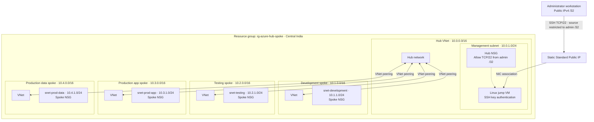

# Azure Hub-and-Spoke Network Architecture

This project defines an Azure hub-and-spoke network in Central India. Administrators connect to the hub jump VM through a static public IP; no VPN is used.

## Network topology

## Network address plan

| Network | Address space | Subnet |
| --- | --- | --- |
| Hub | `10.0.0.0/16` | Management `10.0.1.0/24` |
| Development | `10.1.0.0/16` | `10.1.1.0/24` |
| Testing | `10.2.0.0/16` | `10.2.1.0/24` |
| Production app | `10.3.0.0/16` | `10.3.1.0/24` |
| Production data | `10.4.0.0/16` | `10.4.1.0/24` |

## Access and boundaries

- **No VPN:** No VPN gateway or connection is deployed.
- **Public entry point:** The jump VM is the only resource with a public IP. Inbound SSH is restricted to the administrator's current public IPv4 `/32` and uses SSH key authentication.
- **Private spoke access:** Hub-to-spoke VNet peerings carry traffic between the management network and spokes. Spoke NSGs allow SSH from the hub management subnet and deny other virtual-network inbound traffic.
- **No spoke workloads:** The Terraform configuration creates network infrastructure and the jump VM, but does not create workload VMs in the spokes.
- **No firewall or forced tunneling:** The configuration does not include Azure Firewall or custom route tables. Spokes are not directly peered to one another.
- **Changing public IP:** Update the SSH source CIDR when the administrator's public IP changes.

Review the Terraform plan, access rules, and Azure costs before applying infrastructure.
