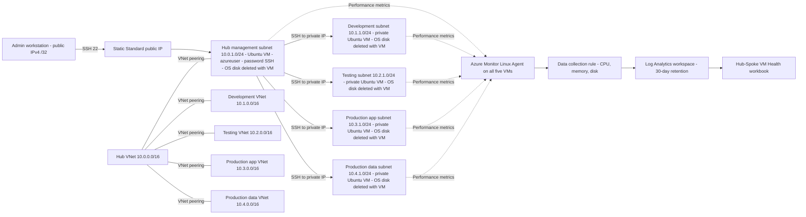

# Azure Hub-and-Spoke Network Architecture

This project provisions five Ubuntu VMs in Central India: one public-facing jump VM in the hub and one private VM in each spoke. Azure Monitor collects basic performance metrics for all five VMs.

## Network topology

## Network address plan

| Network | Address space | Subnet |
| --- | --- | --- |
| Hub | `10.0.0.0/16` | Management `10.0.1.0/24` |
| Development | `10.1.0.0/16` | `10.1.1.0/24` |
| Testing | `10.2.0.0/16` | `10.2.1.0/24` |
| Production app | `10.3.0.0/16` | `10.3.1.0/24` |
| Production data | `10.4.0.0/16` | `10.4.1.0/24` |

## Access and boundaries

- **Connectivity:** Hub and spoke VNets communicate through VNet peering.
- **Public entry point:** Only the hub VM has a public IP. SSH is restricted to the administrator's current public IPv4 `/32`.
- **Password authentication:** All five Ubuntu VMs use the `azureuser` account and a password supplied locally through a sensitive Terraform variable. No SSH keys are configured. Use a new strong password; never commit it to GitHub.
- **Private spoke access:** Spoke VMs have no public IP. Their NSGs allow SSH only from the hub management subnet; connect to them from the jump VM over hub-to-spoke peering.
- **Disk cleanup:** AzureRM is configured to delete managed OS disks when their VMs are deleted.
- **Monitoring:** Azure Monitor Linux Agent collects CPU, memory, and disk counters every 60 seconds. Log Analytics retains data for 30 days; ingestion and retention may incur charges. The workbook shows recent measurements and a one-hour trend.
- **Network routing:** Hub-to-spoke peering is direct; there is no Azure Firewall, forced tunneling, or direct spoke-to-spoke peering.
- **Costs:** Five running VMs, their managed disks, the Standard public IP, and Log Analytics can incur charges. Free-trial coverage is not guaranteed.

Review access rules, the Terraform plan, and Azure costs before applying infrastructure.
