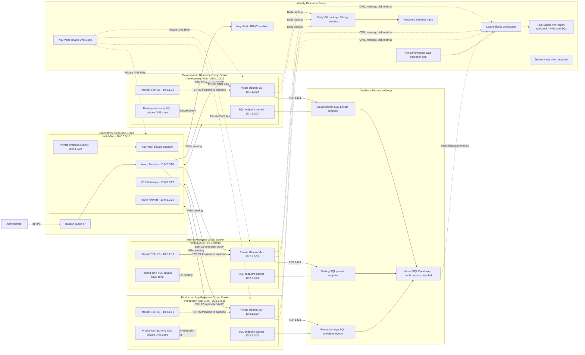

# Azure Hub-and-Spoke Landing Zone Architecture

This case-study design provisions a Central India hub and three workload spokes, a shared Identity Resource Group for secrets and monitoring, and a dedicated Database Resource Group for private Azure SQL Database. Each spoke contains one private Ubuntu VM.

## Traffic flow

1. An administrator connects over HTTPS to the Azure Bastion public IP in the Connectivity Resource Group's hub.
2. Bastion connects directly to each spoke VM's private IP over hub-to-spoke VNet peering. This is the configured administrative path; it does not pass through the spoke load balancers.
3. Each spoke VM reaches the shared Azure SQL Database over TCP 1433 through its own SQL private endpoint and private DNS zone. SQL public network access is disabled.
4. Azure Monitor sends VM performance counters and SQL Basic metrics to the Log Analytics workspace in the Identity Resource Group. The Hub-Spoke VM Health workbook displays both.

## Network topology

## Address plan

| Network | Address space | Subnet(s) |
| --- | --- | --- |
| Hub | `10.0.0.0/16` | AzureFirewallSubnet `10.0.1.0/26`; AzureBastionSubnet `10.0.2.0/26`; GatewaySubnet `10.0.3.0/27`; private endpoints `10.0.4.0/24` |
| Development | `10.1.0.0/16` | VM and internal LB `10.1.1.0/24`; SQL private endpoint `10.1.2.0/24` |
| Testing | `10.2.0.0/16` | VM and internal LB `10.2.1.0/24`; SQL private endpoint `10.2.2.0/24` |
| Production app | `10.3.0.0/16` | VM and internal LB `10.3.1.0/24`; SQL private endpoint `10.3.2.0/24` |

The `10.0.4.0/24` subnet is reserved for private endpoints in the hub and currently hosts the Key Vault private endpoint. It lets hub resources reach Key Vault privately; it is not part of VM or SQL monitoring. One endpoint uses one private IP, so `/24` is larger than required for the current design and leaves room for future private endpoints. A smaller prefix such as `/27` could be used if the address plan is revised before deployment.

There is no Production Data VM or `10.4.0.0/16` spoke. Azure SQL Database is the shared PaaS database in its own resource group.

## Resource group boundaries

- **Connectivity:** hub VNet, Azure Firewall, Azure Bastion, VPN Gateway and their public IPs, plus the hub subnet and private endpoint for Key Vault.
- **Identity:** Key Vault and its private DNS zone and VNet links, Log Analytics workspace, Azure Monitor data collection rule and workbook, Recovery Services vault and VM backup policy, and optionally Network Watcher.
- **Development Resource Group Spoke, Testing Resource Group Spoke, Production App Resource Group Spoke:** each workload VNet, VM subnet, NSG, Ubuntu VM, internal SSH load balancer, SQL private endpoint subnet, and its own SQL private DNS zone.
- **Database:** Azure SQL logical server/database and three SQL private endpoint resources. Each endpoint connects to one spoke subnet; SQL endpoints are not placed in the hub.

## Access, routing, and operations

- Azure Bastion is the administrator entry point. Bastion connects directly to each spoke VM's private IP; the VMs have no public IPs. VM OS disks are deleted with their VMs.
- Each spoke has a separate Standard internal load balancer on TCP 22 with one VM backend. The load balancer frontend is a private access path, not the configured Bastion connection path or a high-availability pool.
- Hub-to-spoke VNet peering provides private network reachability. There is no direct spoke-to-spoke peering. The SQL DNS zones are linked only to their corresponding spokes, and each SQL endpoint subnet allows TCP 1433 from its local spoke while denying other VNet sources, including the hub.
- The SQL logical server has public network access disabled. Each workload uses its own private endpoint to reach the shared database. Azure SQL uses Azure-managed standard backups only; it is not protected by the VM Recovery Services vault and no long-term retention policy is configured here.
- Key Vault public network access is disabled. Its private endpoint is in the hub, and private DNS links allow name resolution from the hub and all three spokes. RBAC is enabled; grant workload identities only the required data-plane roles before applications use the vault.
- Azure Monitor collects CPU, memory, and disk counters for the three VMs. SQL Basic metrics are sent to the same Log Analytics workspace and shown in the Hub-Spoke VM Health workbook. The Recovery Services vault protects the VMs daily with 30-day retention.
- The VPN Gateway resource is provisioned in the hub; connection details must be configured separately. Direct spoke traffic is not forced through the Firewall; firewall rules and UDRs are not configured.
- Network Watcher creation is disabled by default because Azure permits one per subscription/region. Enable it only after confirming that no watcher already exists in Central India.
- Firewall, Bastion, VPN Gateway, public IPs, load balancers, private endpoints, VM backups, SQL metric ingestion, Log Analytics, and SQL usage may incur charges. Review current Azure pricing and the plan before deployment.
